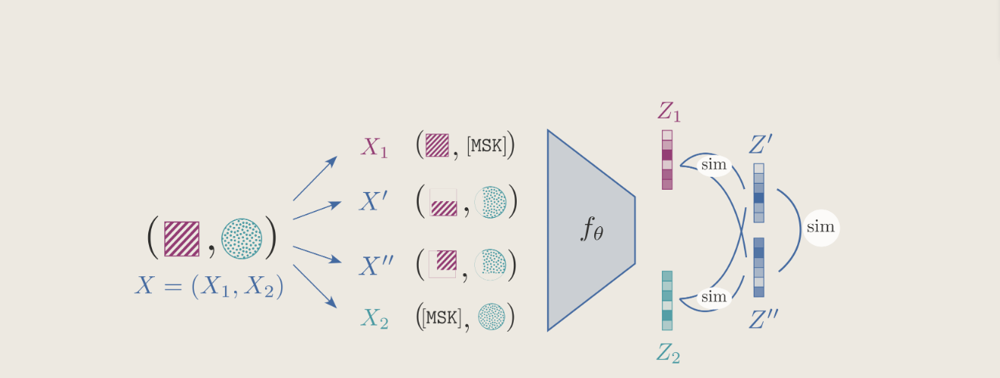
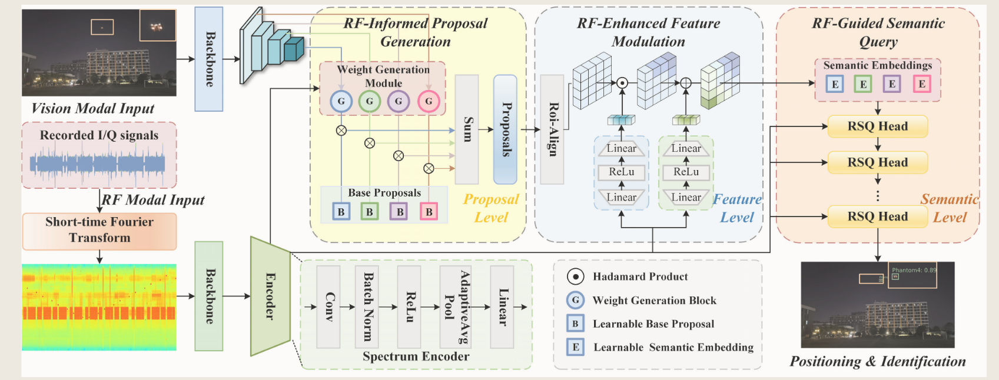

# LowSky-UAV-Papers
A curated reading list for low-altitude UAV control, recognition, navigation, localization, and multimodal information processing.

## 开放词汇-无人机-导航/航迹预测/航迹规划
### 2026：
### [1] 1Rao P, Zhang W, Balestriero R, et al. Skyjepa: Learning long-horizon world models for zero-shot sim-to-real control of quadrotors[J]. arXiv preprint arXiv:2606.23444, 2026.（GB/T引用格式）
SkyJEPA：面向四旋翼无人机零样本 sim-to-real 控制的长时程世界模型学习

摘要

精确的动力学模型对于机器人系统的知情决策至关重要，特别是对于在不确定条件下运行的敏捷飞行器而言。神经网络动力学模型对于捕获复杂的非线性效应具有吸引力，但现有的预测方法难以进行长时预测，因为它们的自回归滚动机制放大了误差随时间的变化。联合嵌入预测结构( Joint Embedding Predictive Architectures，JEPA )通过在潜在空间中建模动态提供了一种令人信服的替代方案，但先前JEPA风格的机器人导航方法主要是针对运动学级规划进行研究的，在高频控制方面的研究有限。在这项工作中，我们介绍了用于实时四旋翼控制的JEPA风格模型。 该方法将潜在动力学模型与一种新颖的物理启发探测器相结合，将冻结的潜在状态映射到可解释的状态，从而实现基于物理的长视距预测。此外，我们将学习到的模型与基于采样的最优控制解决方案相结合，以利用其在嵌入式硬件上实时控制的预测能力。最后，为了减少对昂贵和不安全的真实世界数据收集的依赖，我们开发了用于自动生成数据集的结构化管道。大量的开环和室外闭环实验证明了准确的预测，鲁棒的零样本实时传输，以及在不同操作条件下的强泛化能力。

对提出的框架进行概述:我们学习了一个JEPA风格的潜在动力学模型，并通过一个物理启发的探测器将抽象的嵌入映射到物理上有意义的状态，从而实现了稳定的长视距四旋翼飞行器预测。该模型完全基于领域随机化的仿真数据进行训练，并部署在基于采样的控制器中，在室外飞行实验中得到了验证，实现了实时执行和鲁棒的零样本近真实传输。

## 开放词汇-低空-感知/识别/检测/定位

## 低空-多模态信息处理

## VLA

## 多模态hash检索

## 多模态信息融合

### 综述性论文

[1] DUFUMIER B, CASTILLO NAVARRO J, TUIA D, et al. What to align in multimodal contrastive learning?[C]//International Conference on Learning Representations. Vienna: ICLR, 2025.

摘要

    人类通过多感官整合感知世界，融合不同模态的信息以调整自身行为。基于对比学习的对齐是多模态自监督学习的有效方案：该方案将每种模态视作同一实体的不同视图，在共享表征空间中对齐跨模态特征。但该方法存在固有局限 —— 它仅能学习模态间共享冗余信息，而多模态交互还存在其他形式。本文提出 CoMM（Contrastive Multimodal）对比多模态学习策略，支持各模态在统一多模态空间内交互。该方法不再施加跨模态 / 模态内约束，而是通过最大化多模态特征增强版本之间的互信息完成表征对齐。理论分析表明，该范式可以自然解耦出**共享信息、协同信息、独有信息，能够刻画冗余之外的多模态交互。实验分为受控环境与真实场景：受控实验证明 CoMM 可有效捕获冗余、独有、协同三类信息；真实场景实验证明 CoMM 能够学习复杂多模态交互，在 7 项多模态基准任务上取得 SOTA 效果。
     
框架概述：本文提出 CoMM 这一对比多模态学习框架，摒弃传统多模态对比学习对单模态特征施加显式跨模态或模态内对齐约束、仅挖掘模态间冗余共享信息的固有范式，先利用独立编码器提取各模态特征，再将特征融合得到统一的多模态联合表征，通过对该联合表征实施两组不同的数据增强，以 InfoNCE 损失最大化增强后联合表征之间的互信息，依托偏信息分解理论，该优化目标可自然解耦并捕获模态共享信息、模态独有信息以及模态协同增益信息，突破仅学习冗余信息的局限，在受控实验中验证了其对三类信息的建模能力，并在七项真实多模态下游任务上学习复杂多模态交互，取得了当前最优性能。

### 射频+视觉

2026:

[1] WAN Y Y, LIANG H T, WU G Y, et al. **Precise RF-Vision Fusion UAV Positioning and Identification for 6G Spectrum Security**[J]. IEEE Journal on Selected Areas in Communications, 2026, 44(10): 3949-3964. DOI:10.1109/JSAC.2026.3671229

摘要

    在未来智能网络中，对未经授权的无人驾驶航空器（UAV）进行精确定位与识别，对于频谱安全和隐私保护至关重要。尽管已经研究了各种单模态方法，但其性能在传感器特定噪声下会退化，导致性能和鲁棒性欠佳。为应对这些安全挑战，我们提出了一种多层射频（RF）-视觉融合框架，该框架协同利用UAV RF信号的时间-频谱特征与空间-视觉信息，以实现精确且鲁棒的UAV定位与识别。此外，设计了相应的统一RF-视觉融合网络（RFViNet），以利用RF-视觉跨模态互补性和语义协同。具体而言，通过利用新颖的RF信息引导候选生成、RF增强特征调制和RF引导语义查询模块，RFViNet有效利用了RF和视觉模态的互补优势。此外，开发了一个实用的RF-视觉平台，以在各种挑战性条件下评估我们方法的性能。在真实世界数据集上的实验结果表明，所提方法取得了具有竞争力的85.8%平均精度AP50，凸显了其在未来智能无线网络中增强频谱安全的潜力。
     
    主要框架概述： 
    针对单射频或视觉模态易受噪声干扰、鲁棒性不足的缺陷，提出多层 RF-Vision 融合框架 RFViNet，同步提取无人机射频信号的时频特征与图像的空间视觉特征，依靠射频引导候选框生成、射频增强特征调制、射频引导语义查询三大核心模块挖掘跨模态互补性与语义协同性，实现多模态信息深度融合，配套搭建实测平台在复杂场景下开展验证，在真实数据集上达到 85.8% 的 AP₅₀精度，可稳定完成无人机定位与识别任务，提升 6G 无线网络频谱安全防护能力。

## 锂电池分类

